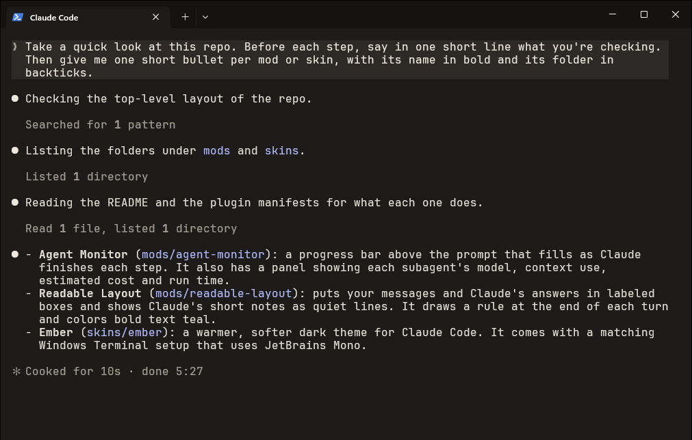
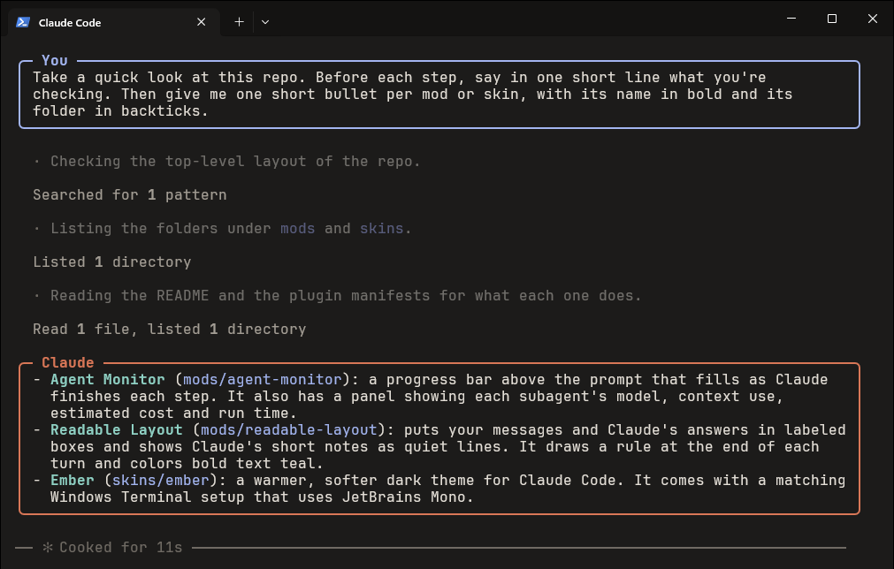

# Readable Layout

In the terminal, a Claude Code session is one long stream. Your message, Claude's short notes ("I'll check the config first"), its tool calls and its final answer all start with the same bullet in the same style. That makes it hard to tell who is talking, what Claude is doing, and which part is the answer you need to read.

Readable Layout gives every part of a turn its own look. Here is the same conversation in stock Claude Code and with the mod, both with the [Ember](../../skins/ember) skin:

**Before**



**After**



## What changes

- **Your messages** sit in a box labeled **You**, in your theme's blue.
- **Claude's answers** sit in a box labeled **Claude**, in Claude's orange. Anything longer than a line or two counts as an answer. Inside the box it renders as before: headings, lists, tables, code blocks and links.
- **Bold text stands out.** Claude Code draws bold text in the same color as everything else, only thicker, and at terminal font sizes that is easy to miss. Readable Layout draws it bold and in a soft teal, so key words and the lead-in of each list item catch your eye. Teal sits opposite Claude's orange on the color wheel, so bold text never blends into the orange boxes and labels, and inline `code` keeps its own blue.
- **Claude's short notes** between steps become quiet, indented lines with a blank line above each one, so every note sits with the step it describes.
- **Tool activity** ("Read 1 file", "Searched for 1 pattern") keeps Claude Code's own quiet style, so you can skim past it.
- **Each turn ends with a rule** across the screen that shows how long it took, so you can see where one exchange stops and the next begins.

Notifications from background tasks, messages from other agents, permission prompts, diffs and command output are left exactly as Claude Code draws them.

## Installing

Type this at the Claude Code prompt:

```
/plugin install readable-layout --marketplace GarvitNangru/claude-code-mods
```

It asks whether to add this repo as a marketplace. Say `y` and pick a scope; the user scope loads it in every session. It starts working right away, no restart needed.

To update it later, run `claude plugin update readable-layout@garvit-mods`, then `/reload-plugins` in an open session. To remove it, run `/plugin uninstall readable-layout@garvit-mods`. To run it from a clone instead, see [Trying one from a clone](../../README.md#trying-one-from-a-clone).

## Settings

`Claude text to box` in `/config` has two choices:

- `answers` (the default) boxes replies of more than a line or two and shows one-line notes as quiet lines.
- `all` boxes everything Claude writes, notes included.

`Bold text` has three:

- `color` (the default) draws bold text in your theme's cyan: a soft teal in Ember, verdigris in Firelight, a deeper cyan in Claude Code's own dark and light themes.
- `highlight` puts a soft background behind bold text, like a marker pen, if you'd rather keep the text color unchanged.
- `off` leaves bold text exactly as Claude Code draws it.

For a mod loaded from a folder, set them in `~/.claude/settings.json` instead:

```json
{ "pluginConfigs": { "readable-layout": { "options": { "boxes": "all", "bold": "highlight" } } } }
```

## Good to know

- Only the terminal changes. The desktop app, VS Code and mobile already lay a conversation out on their own, so they're left alone.
- The box and rule colors come from your theme, so they match whatever theme you use. It's designed alongside the [Ember](../../skins/ember) skin.
- To color bold text, the mod draws the paragraphs, headings and lists that contain it itself. Everything else is still drawn by Claude Code: code blocks, tables, quotes, and any part of a reply without bold. Bold text inside a table or a quote stays plain bold.
- The boxes have a line above and below but nothing at the sides, so text you select and copy from the terminal comes out without any border characters.
- It only changes how the transcript is drawn. What you and Claude wrote, and what's saved, stay exactly the same. Ctrl+O still shows the full transcript.

## Development

```
claude plugin validate mods/readable-layout
claude plugin test mods/readable-layout
```
