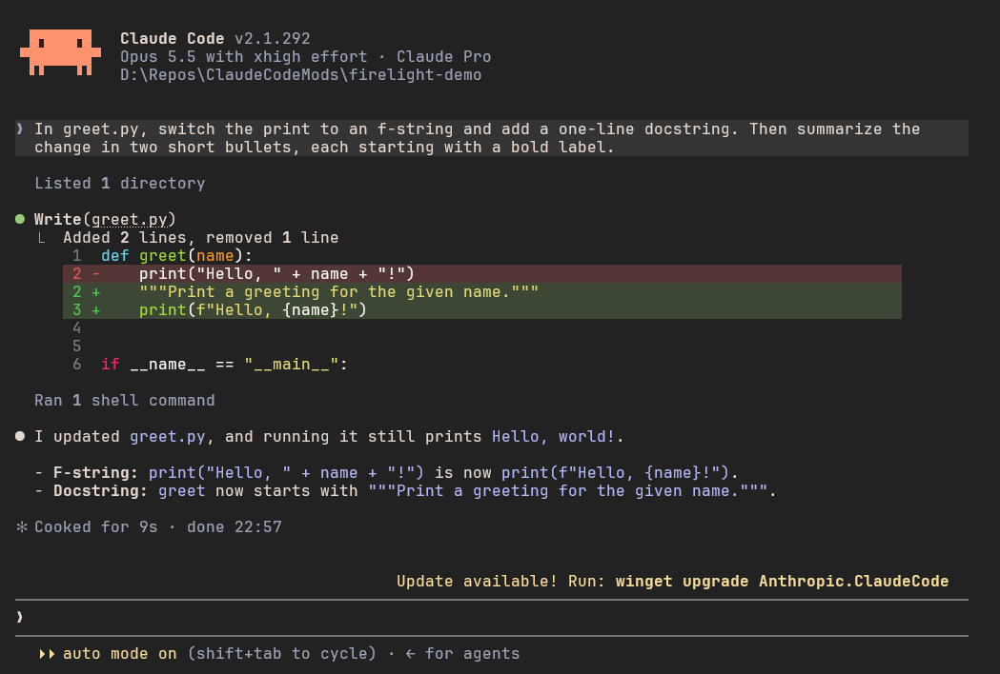

# Firelight

Claude Code themes in [Firelight](https://github.com/ridusaini/firelight), a color palette made by [ridusaini](https://github.com/ridusaini), plus a matching Windows Terminal look.

Firelight is named after the way fire changes color as it grows. Its accents run from rose through ember, coral, apricot and honey, then over to fern, verdigris, cornflower, lilac and orchid. It has neutral backgrounds and text that goes from cool to warm. It comes in three variants, and this skin has all of them:

| Variant | Look | Main text against the background |
| --- | --- | --- |
| **Coal** | Dark, with the most contrast. Start here. | 11.3:1 |
| **Smoulder** | Dark, but softer: a lighter grey background and gentler text | 8.8:1 |
| **Ash** | Light and warm | 9.1:1 |

Every color comes from the palette. This skin only decides which Firelight color goes where in Claude Code and Windows Terminal. Where the palette doesn't have a color Claude Code needs, the skin mixes one from Firelight's own colors, and [Changes from the palette](#changes-from-the-palette) lists each of those.



## What it changes

**In Claude Code (the themes).** Like [Ember](../ember), text falls into three clear levels, using the shades Firelight suggests for each job:

| Level | Used for | Firelight color | Contrast in Coal |
| --- | --- | --- | --- |
| Primary | Claude's replies and anything you need to read | `fg1`, body text | 11.3:1 |
| Secondary | Tool output, file names, metadata | `fg4`, labels and captions | 6.3:1 |
| Tertiary | Hints, borders, placeholders | `bg5`, subtle controls | 3.5:1 |

Your own messages sit on a raised block (`bg2`, or `bg0` in Ash), so you can find where each exchange starts when you scroll back. The accents follow the jobs Firelight gives them:

| In Claude Code | Firelight color |
| --- | --- |
| Claude's orange: the spinner, the logo, the Claude box in Readable Layout | `coral`, shimmering to `apricot` |
| Permission prompts, selected menu items, the You box and inline code in Readable Layout | `cornflower`, shimmering to `lilac` |
| Bold text in Readable Layout, plan mode, background tasks | `verdigris` |
| Auto-accept, skills | `orchid` |
| Bash mode | `rose` |
| Success, errors, warnings | `fern`, `ember`, `honey` |
| Subagent colors and the rainbow `ultrathink` text | the Firelight accent closest to each color |

Firelight suggests `rose` as the main accent. The skin uses `coral` instead, the palette's closest color to Claude's orange, so Claude still looks like Claude.

**In the terminal around it.** A Claude Code theme only colors Claude Code's own text, so on its own Coal's text would sit on whatever background your terminal has. While a Firelight theme is picked, the skin also switches the terminal's background, text color, cursor and 16 ANSI colors to that variant, so the text is always on the background it was made for. Switching between variants in `/theme` switches the terminal along with it, and picking a theme that isn't Firelight, or quitting Claude Code, gives the terminal its own colors back. This works in terminals that accept the standard color-changing codes (OSC 4, 10, 11 and 12), which most current ones do. I've tested it in Windows Terminal only. If Claude Code is killed instead of quit, the colors stay until you close the tab.

**In Windows Terminal (the look).** All three variants as color schemes, mapped exactly the way Firelight's [suggested terminal colors](https://github.com/ridusaini/firelight/blob/main/resources/suggested-uses.json) lay them out, with a `rose` cursor. The rest matches Ember: the [JetBrains Mono](https://www.jetbrains.com/lp/mono/) NL font at 12 pt with 20% more line height, padding around the text, real bold for bold text, and a tab bar that blends into the window.

The themes change colors only. To also change how a conversation is laid out, add the [Readable Layout](../../mods/readable-layout) mod. It picks up Firelight's colors on its own.

## Installing

### The Claude Code themes

Type this at the Claude Code prompt:

```
/plugin install firelight --marketplace GarvitNangru/claude-code-mods
```

It asks whether to add this repo as a marketplace. Say `y` and pick a scope; the user scope loads it in every session. Then run `/theme` and pick **Firelight Coal**, **Firelight Smoulder** or **Firelight Ash**. Each is listed as "from firelight".

### The Windows Terminal look

You don't need this part for the colors, since the themes set those themselves. It adds the font, the spacing and the matching tab bar, and makes the terminal Firelight-colored before Claude Code starts too. It changes Windows Terminal's own settings, so it's a separate step, and it's Windows only. Clone this repository and run the script:

```
git clone https://github.com/GarvitNangru/claude-code-mods.git
powershell -ExecutionPolicy Bypass -File claude-code-mods\skins\firelight\windows-terminal\install.ps1
```

It does three things:

1. Installs JetBrains Mono for your Windows account, if you don't have it yet. It downloads the official release from JetBrains' GitHub page and needs no admin rights. Pass `-SkipFont` to keep Cascadia Mono instead.
2. Adds all three Firelight color schemes and window themes, so you can switch between them later in Windows Terminal's settings.
3. Applies Coal, the font and the spacing to your **Windows PowerShell** profile. Pass `-Variant Smoulder` or `-Variant Ash` for another variant, and `-ProfileName "PowerShell"` to style a different profile.

Pick the same variant here as in `/theme`, so the terminal and Claude Code share one background.

Colors and spacing change immediately. If the font doesn't switch, close and reopen Windows Terminal.

Before changing anything, the script saves a backup of your settings next to the original, and it prints the one command that puts the backup back. Running it again is safe; it replaces Firelight's settings rather than adding them twice. If you already use Ember, its scheme stays installed.

If you'd rather make the change by hand, `windows-terminal/firelight.json` holds the pieces: the color schemes go in `schemes`, the window themes in `themes`, and the profile values in the profile you use for Claude Code, along with `"colorScheme": "Firelight Coal"`.

### Updating or removing it

To update the themes later, run `claude plugin update firelight@garvit-mods`, then `/reload-plugins` in an open session. To remove them, run `/plugin uninstall firelight@garvit-mods`. To undo the Windows Terminal part, run the restore command the install script printed.

## Changes from the palette

Firelight's community guidelines ask themes to note any palette changes, so here is everything this skin mixes or changes:

- **Diff backgrounds.** Changed lines use `fern` and `ember` laid over `bg1`: 22% for a changed line, 12% for a dimmed one, 35% for the changed words. Firelight's own `diff-add` and `diff-remove` aren't used, because the two aren't equally strong. In Coal the removed color is 1.13:1 against the background, and in Smoulder and Ash the added color nearly disappears. An editor marks changed lines in the gutter too, but in Claude Code the background is the only sign, so added and removed lines need the same weight.
- **Selection.** `lilac` at 25% over `bg1`, stronger than the 12% Firelight suggests, so selected text is easy to see.
- **Bash and memory blocks.** `rose` and `cornflower` at 12% over `bg1`, the same opacity Firelight uses for selection. The palette has no tinted backgrounds for these.
- **Rainbow shimmer.** The `ultrathink` rainbow shimmers toward `fg0` (in Ash, toward `bg0`), since the palette has no lighter shade of each accent.
- **Ash's accents** are about 3:1 against its background, as Firelight's own README points out. They're fine for labels, borders and spinners. But Readable Layout's colored bold text is a little faint in Ash. If that bothers you, set its `Bold text` option to `highlight`, or use Coal or Smoulder.

## Tuning it

Each variant is one small JSON file in `themes/`. Each key overrides one color of Claude Code's built-in dark theme, or light theme for Ash, and any key you leave out keeps its default. Colors are `#RRGGBB` hex. The terminal schemes and font settings live in `windows-terminal/firelight.json`, and the colors the skin sets in your terminal while Claude Code runs come from the same schemes. If 12 pt is too small on your screen, change `size`, and if the lines feel too airy, lower `cellHeight` towards `1.1`.

After editing a theme, start a new session, or reselect it in `/theme`, to see the change.

## Credits

The Firelight palette is by [ridusaini](https://github.com/ridusaini) and the Firelight contributors. You can browse it on the [palette site](https://ridusaini.github.io/firelight/), try it in the [Playground](https://ridusaini.github.io/firelight/playground/), and find other apps' themes on the [Community page](https://ridusaini.github.io/firelight/community/). It's released under the MIT License, and [NOTICE.md](NOTICE.md) carries its copyright notice. The skin itself, meaning the theme mappings and the install script, is MIT like the rest of this repo.
